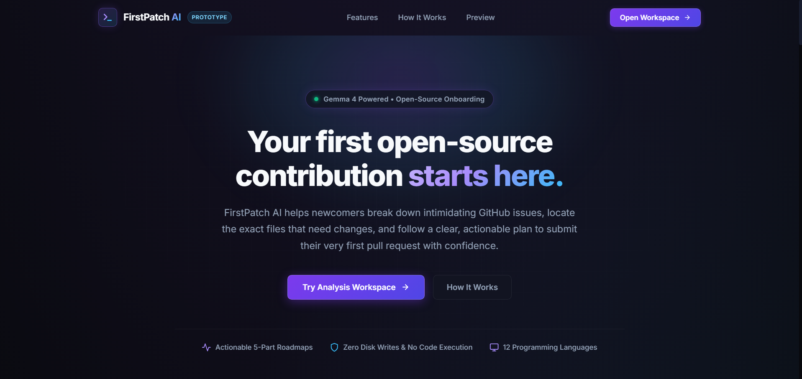
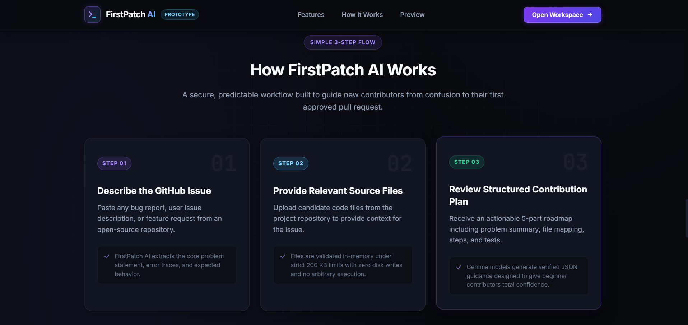
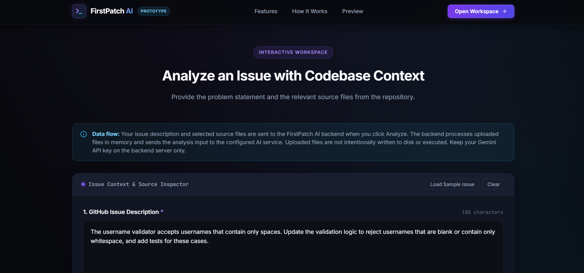
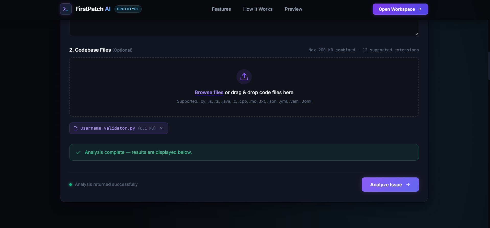
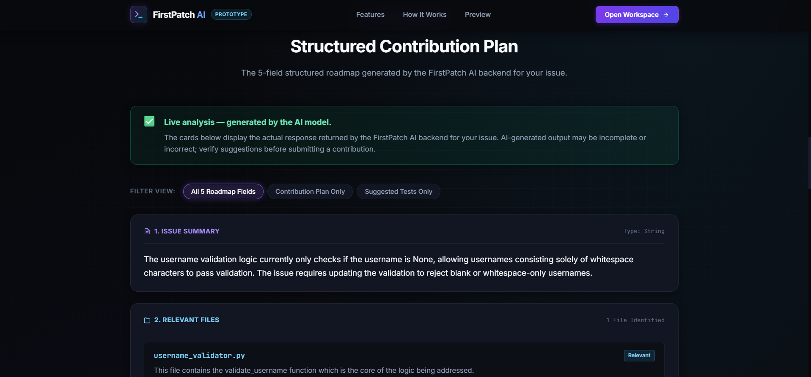
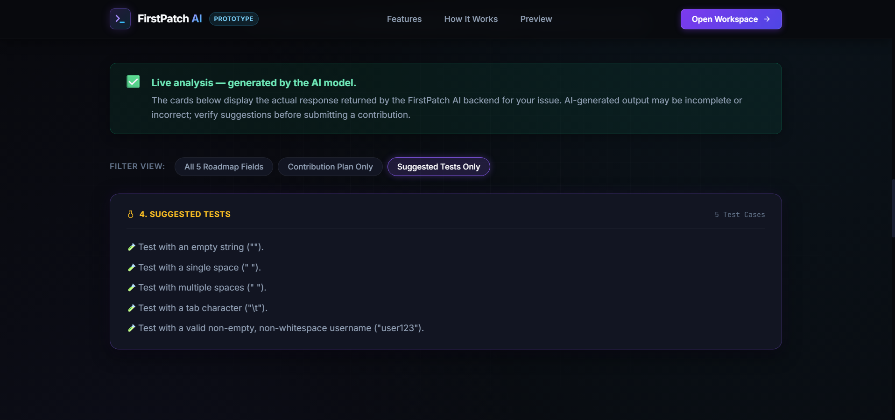

# FirstPatch AI

**An AI-powered open-source contribution onboarding assistant for beginners.**

FirstPatch AI helps developers understand unfamiliar code, discover potential problems, and find a starting point for a contribution.

Users can upload selected source files without writing an issue description. FirstPatch AI explains what the supplied files appear to do, identifies evidence-backed potential problems, and offers beginner-friendly steps and suggested tests. An optional issue description focuses the analysis on a reported symptom. Results are limited to uploaded files and are advisory; uploaded code is never executed.

The project includes a Streamlit application for interactive analysis and offline demonstration, alongside a React + TypeScript frontend backed by a FastAPI REST API.


## Screenshots

### 1. Application Interface



### 2. Analysis in Progress



### 3. Analysis Workspace



### 4. File Upload



### 5. Contribution Plan



### 6. Suggested Tests




## What It Does

### Capabilities

- **Code Understanding:** Explains the apparent purpose of selected files, important functions/classes, and visible relationships between supplied files.
- **Potential Problem Discovery:** Highlights suspicious behavior and inferred risks with evidence, impact, and explicit uncertainty.
- **Optional Issue Investigation:** Connects an optional issue description to the uploaded code; states when the selected files are insufficient.
- **Relevant File Identification:** Identifies potentially relevant files from user-supplied source code and explains their relevance.
- **Actionable Contribution Planning:** Breaks a problem into manageable implementation steps.
- **Test Suggestions:** Recommends unit tests, edge cases, and expected behaviors to verify.
- **Uncertainty Reporting:** Highlights assumptions, missing context, and questions that may require further investigation.
- **Structured AI Responses:** Preserves five contribution fields and adds a project overview, file explanations, potential issues, and missing context, all validated by the backend.
- **Prompt Injection Awareness:** Treats issue descriptions and uploaded file contents as untrusted input, with instructions designed to reduce the risk of following malicious embedded directions.
- **Safe In-Memory File Processing:** Validates and decodes supported text files in memory without executing uploaded code or writing uploaded contents to disk.
- **Offline Demo Mode:** Provides a fixed sample analysis without API credentials or network access.
- **Multiple Interfaces:** Supports both a Streamlit interface and a React + TypeScript workspace using FastAPI.

### Current Limitations

- **Read-Only and Advisory:** FirstPatch AI does not implement fixes, execute uploaded code, run the analyzed repository's tests, or create pull requests automatically.
- **User-Supplied Context:** Analysis is limited to files the user provides; the application does not inspect an entire repository.
- **Upload Constraints:** Supports 12 text file extensions, up to 20 files, and a maximum combined upload size of 200 KB (204,800 bytes).
- **Model Dependent:** Live analysis requires an OpenRouter API key and an explicitly free model identifier ending in `:free`.
- **Output Validation:** Responses that do not meet the required schema are rejected rather than silently converted into valid-looking results.
- **Deployment:** A Docker image serves the built React app and FastAPI API from one origin. A hosting provider and its credentials are not bundled with the project.

## File Upload Constraints

FirstPatch AI validates uploaded files before processing their contents.

- **Supported extensions:** `.py`, `.js`, `.ts`, `.java`, `.c`, `.cpp`, `.md`, `.txt`, `.json`, `.yml`, `.yaml`, `.toml` (case-insensitive).
- **Combined size limit:** 200 KB (204,800 bytes), calculated from the actual uploaded file bytes.
- **Encoding:** Valid UTF-8 text only.
- **Empty files:** Rejected.
- **Duplicate filenames:** Rejected.
- **Unsupported extensions:** Rejected.
- **Execution and storage:** Uploaded files are processed in memory; their contents are not executed, imported, or written to disk by the file-processing workflow.

These restrictions reduce risk but do not make arbitrary uploaded content inherently trustworthy.

## Modes of Operation

### 1. Streamlit Demo Mode — Offline Sample

The Streamlit application includes a **Demo mode (offline sample)** option.

- Runs without API credentials or external model requests.
- Displays a fixed, realistic five-section example analysis referencing [`samples/username_validator.py`](samples/username_validator.py).
- Clearly distinguishes sample output from live model-generated results.
- Does not analyze arbitrary uploaded files while using the fixed sample demonstration.

Demo mode is useful for exploring the interface without consuming free-model request quota.

### 2. Live AI Analysis

With demo mode disabled, the backend sends one non-streaming request to OpenRouter's chat completions API. The default configuration uses `nvidia/nemotron-3-ultra-550b-a55b:free`; no paid model fallback is configured.

- Requires one or more uploaded source files. An issue description is optional and focuses the analysis when provided.
- Requests JSON in the prompt, then parses and validates the returned content on the backend; it does not rely on provider-enforced JSON mode.
- Validates the model response before returning the analysis.
- Reports errors when the upstream request fails or the returned content does not satisfy the expected format.
- Does not automatically retry provider requests, avoiding repeated free-quota consumption.

AI-generated suggestions are advisory and should be reviewed before implementation.

### 3. React + FastAPI Workspace

The React frontend provides a workspace for uploading files, optionally describing an issue, and reviewing the generated analysis.

The FastAPI backend handles request validation, invokes the analyzer, and returns structured results to the frontend.

For local development, Vite proxies `/api` to `API_PROXY_TARGET` (default `http://127.0.0.1:8000`). The frontend itself uses the same-origin `/api` route; production serves the UI and API together by default.

## Analysis Response Structure

A successful analysis preserves five contribution fields and adds structured code-understanding fields:

| Field | Description |
|---|---|
| `issue_summary` | A concise explanation of the supplied issue, or a summary of uploaded code and investigation findings when no issue is reported |
| `relevant_files` | Candidate filenames and reasons they may be relevant |
| `contribution_plan` | Actionable steps for investigating and addressing the issue |
| `suggested_tests` | Recommended tests and edge cases |
| `uncertainties` | Assumptions, missing context, and unresolved questions |
| `project_overview` | What the supplied files appear to do together, within the uploaded-file scope |
| `file_explanations` | Per-file purpose, important elements, and visible relationships |
| `potential_issues` | Evidence-backed observed behavior or inferred risks, with file/location when available |
| `missing_context` | Additional information that could clarify an inference |

The application validates the response structure and field types. A successful HTTP response from the model provider does not, by itself, guarantee a valid application-level result.

## Tech Stack

| Component | Technology |
|---|---|
| Language | Python |
| AI integration | OpenRouter chat completions API over HTTPS |
| AI model | Configurable through `OPENROUTER_MODEL`; must end in `:free` |
| Backend | FastAPI, Uvicorn |
| Frontend | React, TypeScript, Vite |
| Alternative interface | Streamlit |
| Automated testing | pytest |

## Getting Started — Windows PowerShell

### Prerequisites

Install the following:

- Python 3.10 or newer, compatible with the project's dependencies
- Node.js and npm (for the React frontend)
- Windows PowerShell
- An OpenRouter API key for live analysis

Git is recommended for version control.

### 1. Create a Python Virtual Environment

Run these commands from the project root:

```powershell
python -m venv .venv
```

Activate the environment:

```powershell
.\.venv\Scripts\Activate.ps1
```

If PowerShell restricts script activation, you can run the virtual environment's Python executable directly for subsequent commands.

### 2. Install Python Dependencies

```powershell
.\.venv\Scripts\python.exe -m pip install -r requirements.txt
```

### 3. Configure Environment Variables

Live model analysis requires `OPENROUTER_API_KEY` and `OPENROUTER_MODEL` in the PowerShell session that runs the backend or Streamlit application.

#### A. Set the API Key Securely

Create or obtain a key through [OpenRouter API Keys](https://openrouter.ai/keys).

Enter the following command:

```powershell
$key = Read-Host "Enter OpenRouter API key" -AsSecureString
```

When prompted, paste the key and press Enter. The characters should remain hidden.

Then assign the key to the environment variable:

```powershell
$env:OPENROUTER_API_KEY = [System.Net.NetworkCredential]::new("", $key).Password
Remove-Variable key
```

The key is held in the current PowerShell session's environment; these commands do not write it to a project file.

#### B. Set the Free Model Identifier

```powershell
$env:OPENROUTER_MODEL = "nvidia/nemotron-3-ultra-550b-a55b:free"
```

The backend rejects model identifiers that do not end in `:free`; it does not select or fall back to paid models. Free model availability and account limits are controlled by OpenRouter and the model provider.

#### C. Verify the Configuration

Check the key without displaying it:

```powershell
if ($env:OPENROUTER_API_KEY) {
    "API key is set"
} else {
    "API key is missing"
}
```

Check the configured model:

```powershell
$env:OPENROUTER_MODEL
```

These environment variables are specific to the current terminal session. Configure them separately in any new terminal that runs live analysis.

**Security:** Never commit API keys, include them in source code, or share them in screenshots, logs, or public repositories. Keep `.env` files and credentials out of version control.

### 4. Run the React + FastAPI Application

This is the recommended workflow for the React workspace.

#### Terminal 1 — Start the Backend

From the project root, in the terminal where the environment variables are configured:

```powershell
.\.venv\Scripts\python.exe -m uvicorn api:app --reload --port 8000
```

The backend should be available at:

- **API base URL:** `http://127.0.0.1:8000`
- **Health endpoint:** `http://127.0.0.1:8000/api/health`
- **Interactive API documentation:** `http://127.0.0.1:8000/docs`

A health check can be performed from another PowerShell terminal:

```powershell
Invoke-RestMethod http://127.0.0.1:8000/api/health
```

A healthy service reports `status: ok`.

Keep this terminal open while using the frontend.

#### Terminal 2 — Start the Frontend

Open another terminal in the project root:

```powershell
cd frontend
npm install
npm run dev
```

Open the local URL printed by Vite, normally:

`http://localhost:5173/`

Keep the frontend terminal running as well.

### 5. Run the Streamlit Application

To use the alternative Streamlit interface, open a terminal in the project root.

For live analysis, configure the required environment variables in that terminal first.

Run:

```powershell
.\.venv\Scripts\python.exe -m streamlit run app.py
```

Open the local URL printed by Streamlit, normally:

`http://localhost:8501/`

The Streamlit demo mode can be used without configuring an API key.

## API Reference

### Health Check

`GET /api/health`

Checks whether the FastAPI service is responding.

### Analyze Uploaded Files

`POST /api/analyze`

Accepts multipart form data containing:

- `files` — one or more uploaded source files, subject to the application's validation rules. At least one file is required.
- `issue_description` — optional issue description used to prioritize the investigation.

A successful response contains the five contribution fields and four additive code-understanding fields documented above. Potential findings are not verified bugs; suggested tests are not executed.

For the exact request schema, response structure, and available API documentation, visit `http://localhost:8000/docs` while the backend is running.

## Production Deployment with Docker

The included Dockerfile builds the React frontend and packages it with FastAPI. The single service serves the UI, API, and health endpoint on the same port, so browser CORS is not needed for the default deployment.

1. In PowerShell, enter the key without echoing it and set the explicitly free model in the current session:

   ```powershell
   $secureOpenRouterKey = Read-Host "Enter OpenRouter API key" -AsSecureString
   $openRouterCredential = [System.Net.NetworkCredential]::new("", $secureOpenRouterKey)
   $env:OPENROUTER_API_KEY = $openRouterCredential.Password
   $env:OPENROUTER_MODEL = "nvidia/nemotron-3-ultra-550b-a55b:free"
   Remove-Variable secureOpenRouterKey, openRouterCredential
   ```

   The key stays out of the image build and command text. Run the container from this same PowerShell session.
2. Build the image from the project root:

   ```powershell
   docker build -t firstpatch-ai:local .
   ```

3. Run it locally:

   ```powershell
   docker run -d --name firstpatch-ai --restart unless-stopped -p 127.0.0.1:8000:8000 -e OPENROUTER_API_KEY -e OPENROUTER_MODEL firstpatch-ai:local
   ```

4. Open `http://localhost:8000/`. Check `http://localhost:8000/api/health`; Docker also runs this endpoint as its container health check.

Stop the local container with `docker stop firstpatch-ai`; remove it afterward with `docker rm firstpatch-ai` if desired. Clear the key from the PowerShell session with `$env:OPENROUTER_API_KEY = $null` when finished.

For a container hosting provider, build from this repository's root `Dockerfile`, provide `OPENROUTER_API_KEY` as a server-side secret and `OPENROUTER_MODEL` as a server-side environment variable, and route public traffic to the container port (the image honors `PORT`, defaulting to `8000`). Do not set provider credentials as `VITE_*` variables or bake them into the frontend build. If hosting the frontend separately, build it with `VITE_API_BASE_URL` set to the backend origin and configure the backend's `CORS_ORIGINS` as a comma-separated list of exact frontend origins. Avoid wildcard origins.

### Production environment variables

| Variable | Required | Purpose |
|---|---|---|
| `OPENROUTER_API_KEY` | For live analysis | OpenRouter key, configured on the backend only |
| `OPENROUTER_MODEL` | For live analysis | OpenRouter model ID; the backend requires the ID to end in `:free` |
| `OPENROUTER_REQUEST_TIMEOUT_SECONDS` | No | Per-request OpenRouter HTTP timeout in seconds; defaults to `30`. Requests are not automatically retried. |
| `ANALYSIS_REQUEST_TIMEOUT_SECONDS` | No | Overall FastAPI analysis deadline in seconds; defaults to `100` and should exceed the upstream timeout. |
| `PORT` | No | HTTP port supplied by the hosting platform; defaults to `8000` |
| `CORS_ORIGINS` | No | Exact comma-separated browser origins for split frontend/backend hosting; blank for same-origin |
| `VITE_API_BASE_URL` | No | Frontend build-time backend origin for split hosting; omit for same-origin |
| `VITE_ANALYSIS_REQUEST_TIMEOUT_MS` | No | Browser request safety deadline in milliseconds; defaults to `105000`, slightly longer than the backend deadline |

The container serves the Vite app at `/`, the API at `/api/*`, and the readiness endpoint at `/api/health`. FastAPI's interactive API documentation is available at `/docs`.

## Running Automated Tests

Run the complete test suite from the project root:

```powershell
.\.venv\Scripts\python.exe -m pytest -q
```

For detailed per-test output:

```powershell
.\.venv\Scripts\python.exe -m pytest -v
```

The automated tests cover the application's file-processing, analyzer-validation, and API behavior. Tests using mocked model responses should run without API credentials or live network requests.

## Project Structure

```text
FirstPatchAi/
├── .env.example
├── .gitignore
├── LICENSE
├── README.md
├── app.py
├── api.py
├── requirements.txt
├── firstpatch/
│   ├── __init__.py
│   ├── analyzer.py
│   └── files.py
├── frontend/
│   ├── src/
│   ├── package.json
│   └── ...
├── samples/
│   ├── .gitkeep
│   └── username_validator.py
└── tests/
    ├── .gitkeep
    ├── test_analyzer.py
    ├── test_files.py
    └── ...
```

- `api.py` — FastAPI application and REST endpoints.
- `app.py` — Streamlit interface and offline demonstration.
- `firstpatch/analyzer.py` — prompt construction, OpenRouter integration, and structured response validation.
- `firstpatch/files.py` — in-memory file validation and decoding.
- `frontend/` — React and TypeScript workspace.
- `samples/` — example source files.
- `tests/` — automated tests.

The tree above is illustrative; the actual repository may contain additional files.

## Contributing

Contributions, bug reports, and suggestions are welcome.

1. Identify a reproducible issue or a focused improvement.
2. Describe the expected behavior.
3. Add or update tests where appropriate.
4. Run the relevant automated tests.
5. Submit a pull request with a clear explanation of the change.

Please do not include credentials, access tokens, or sensitive repository contents in commits.

## License

See [`LICENSE`](LICENSE) for the project's license and terms.

---

**FirstPatch AI — Understand the issue. Find the code. Plan the contribution.**


